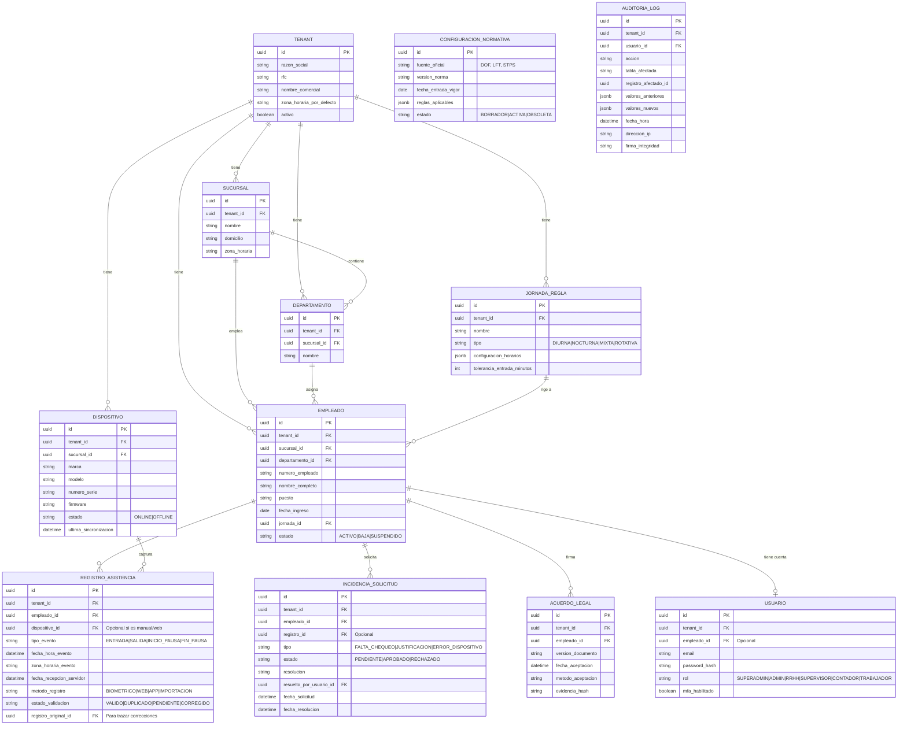

# Modelo de Datos (Esquema Conceptual)

Este documento describe las entidades principales de la base de datos PostgreSQL, garantizando el aislamiento por empresa (tenant) y la trazabilidad legal.

## Consideraciones del Modelo
1. **Multi-empresa (SaaS):** Todas las entidades operativas poseen un `tenant_id` obligatorio.
2. **Inmutabilidad en Registros:** `REGISTRO_ASISTENCIA` no se actualiza (UPDATE) cuando hay una corrección. Se inserta un nuevo registro y se vincula mediante `registro_original_id`, conservando el original.
3. **Auditoría Estricta:** `AUDITORIA_LOG` guarda un historial detallado de todas las operaciones críticas, asegurado opcionalmente con un hash encadenado (`firma_integridad`) para evitar alteraciones no detectadas en la base de datos.
4. **Cumplimiento STPS:** `CONFIGURACION_NORMATIVA` permite versionar reglas legales y `ACUERDO_LEGAL` documenta formalmente la aceptación del empleado al uso de medios electrónicos, como lo estipulan las normativas recientes.
